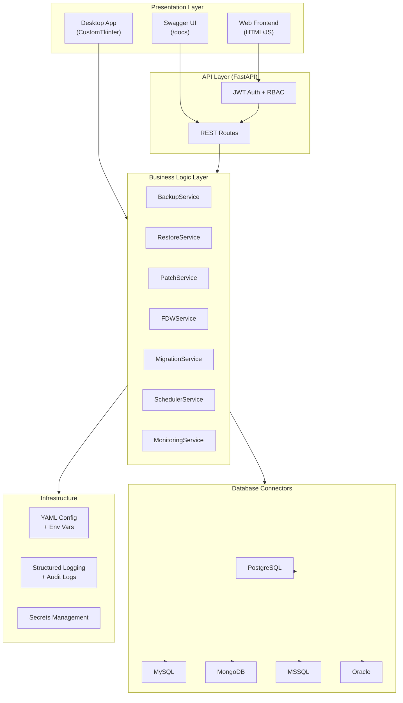
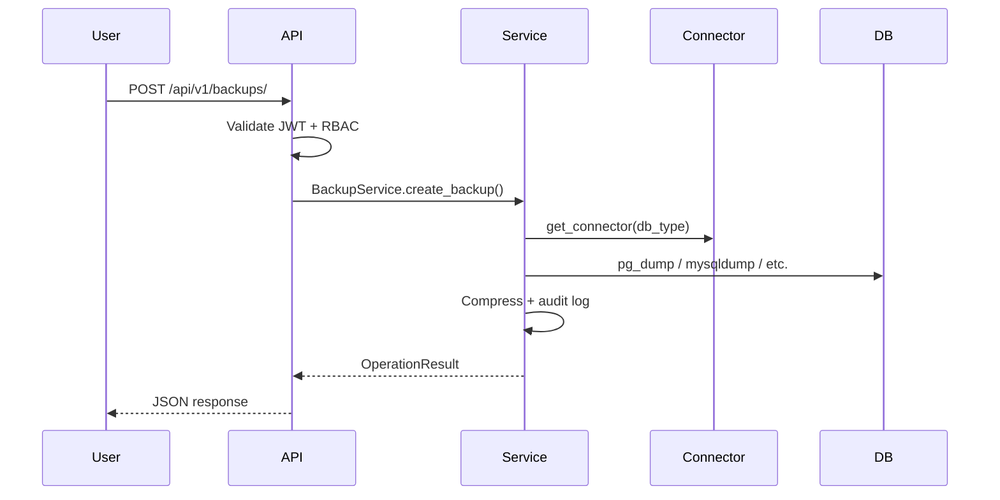

# Database Automation Pro - Architecture

## Overview

Database Automation Pro is a modular Python application for automating database administration tasks across PostgreSQL, MySQL, MongoDB, MSSQL, and Oracle. It follows a layered architecture with clear separation of concerns.

## Architecture Diagram



## Layer Responsibilities

### Presentation Layer
- **Desktop (`desktop/`)**: CustomTkinter GUI with sidebar navigation, dashboard, progress bars, and real-time logs
- **Web Frontend (`frontend/`)**: Lightweight SPA consuming REST APIs
- **Swagger**: Auto-generated OpenAPI documentation at `/docs`

### API Layer (`api/`)
- FastAPI application with JWT authentication
- Role-based access control (admin, operator, viewer)
- RESTful endpoints for all operations
- Dependency injection for services

### Business Logic Layer (`backend/services/`)
- **BackupService**: pg_dump, mysqldump, mongodump, MSSQL/Oracle backups, compression, retention
- **RestoreService**: Cross-database restore with validation
- **PatchService**: SQL patch execution, history, rollback
- **FDWService**: PostgreSQL foreign data wrapper management
- **MigrationService**: Schema/data migration with progress tracking
- **SchedulerService**: Cron-based scheduled backups (APScheduler)
- **MonitoringService**: Health checks, metrics, audit logs

### Database Connectors (`backend/connectors/`)
- Abstract `BaseConnector` interface
- Database-specific implementations with health checks
- Factory pattern via `get_connector()`

### Infrastructure (`backend/core/`, `config/`)
- YAML configuration with environment profiles (dev/test/prod)
- Environment variable overrides (`DAP_*` prefix)
- Structured JSON logging with audit trail
- Custom exception hierarchy

## Design Principles

| Principle | Implementation |
|-----------|----------------|
| **Single Responsibility** | Each service handles one domain (backup, restore, etc.) |
| **Open/Closed** | New DB types added via new connector classes |
| **Liskov Substitution** | All connectors implement `BaseConnector` |
| **Interface Segregation** | Separate schemas per operation type |
| **Dependency Inversion** | Services depend on connector abstractions |

## Data Flow



## Security Model

- JWT tokens (access + refresh)
- Role hierarchy: admin > operator > viewer
- Permission matrix per endpoint
- Audit logging for all mutating operations
- Secrets via environment variables or secrets file

## Deployment Topology

```
┌─────────────────┐     ┌─────────────────┐
│  Desktop Client │     │   Web Browser   │
└────────┬────────┘     └────────┬────────┘
         │                       │
         │ Direct service calls  │ HTTP/REST
         │                       │
         ▼                       ▼
┌─────────────────────────────────────────┐
│         FastAPI Server (uvicorn)         │
│         + APScheduler (background)       │
└────────────────────┬────────────────────┘
                     │
         ┌───────────┼───────────┐
         ▼           ▼           ▼
    PostgreSQL    MySQL      MongoDB ...
```

## Extension Points

1. **New database type**: Implement `BaseConnector`, register in factory
2. **New operation**: Create service class + API routes + desktop view
3. **New auth provider**: Replace `jwt_handler.py` user store with LDAP/OAuth
4. **Persistent state**: Replace in-memory operation tracking with Redis/PostgreSQL
